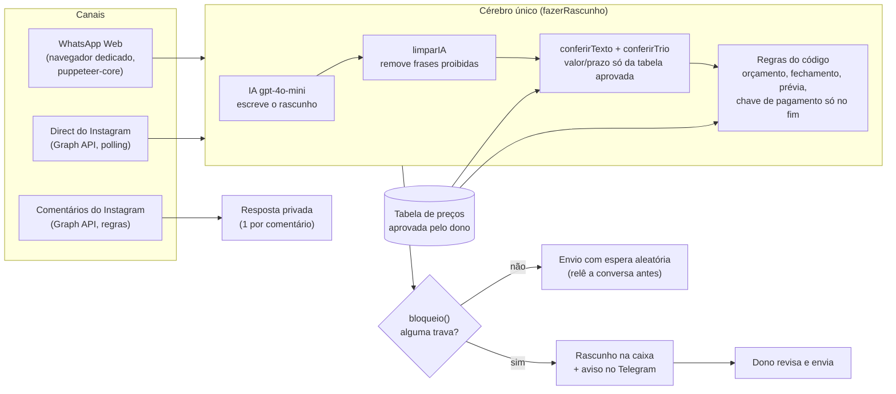

# Robô de atendimento e vendas (WhatsApp + Instagram)

> **English summary.** A sales and customer-service bot I built solo for my own software studio, [ClickGo](https://clickgo.dev.br). One shared "brain"
> answers leads on WhatsApp (WhatsApp Web driven through a dedicated browser) and Instagram Direct (Graph API polling),
> plus a rule-based Instagram comment bot. An LLM (gpt-4o-mini) drafts replies, but deterministic code decides what can
> be sent: prices only from an owner-approved table, no invented discounts, guarantees, urgency or social proof, the
> payment key only after the project briefing is complete, and every doubtful reply becomes a draft for a human.
> It is covered by an offline test battery of **181 scripted conversations** (216 graded results across the two
> channels, including prompt-injection and false-positive cases) scored 0–10 by a fixed rubric, with a **minimum
> score of 8** per case. Full source is private; this repo is
> a showcase with trimmed, anonymized excerpts.

Autor: **Erinaldo Gomes** ([@erinaldogomes](https://github.com/erinaldogomes)), Análise e Desenvolvimento de Sistemas,
fundador da [ClickGo](https://clickgo.dev.br).
Desenvolvedor solo que constrói sistemas que rodam sozinhos usando IA (programo com Claude Code), migrando para
QA e automação de testes.

---

## O problema

Minha empresa de software, a **[ClickGo](https://clickgo.dev.br)** (Instagram [@clickgo.dev](https://www.instagram.com/clickgo.dev/)), faz sites, cardápios digitais e robôs para negócios locais. A prospecção gera respostas
no WhatsApp e no direct do Instagram a qualquer hora, e responder tudo à mão não escala para uma pessoa só.

Um robô de vendas com IA resolve a velocidade, mas cria um risco sério: modelos de linguagem **inventam**. Inventam
preço, desconto, prazo, "nossos clientes adoraram", "só hoje", e até "recebi seu pagamento". Para um negócio pequeno,
uma frase dessas vira prejuízo ou perda de confiança. O desafio real não era fazer a IA responder; era garantir que
**nada errado saísse**, e provar isso com testes.

## O que faz

- **WhatsApp:** lê apenas as conversas dos negócios que eu contatei pela prospecção (abre cada conversa pelo número,
  nunca lista as outras), transcreve áudio localmente e responde no ritmo de gente (espera aleatória antes de enviar).
- **Direct do Instagram:** o mesmo cérebro, lendo as conversas pela Graph API (polling, sem webhook). Só responde
  quem mandou mensagem, nunca inicia conversa.
- **Comentários do Instagram:** "comenta PALAVRA que eu te mando": sem IA, por regras, manda uma resposta privada
  para quem comentou a palavra-chave do post (a palavra sozinha ou com uma cortesia, como "quero SITE"; comentário
  que recusa ou ataca não recebe direct).
- **Conduz a venda até o fechamento:** diagnóstico, opções de pacote com valores da tabela aprovada, objeções
  ("tá caro", "vou pensar", "meu sobrinho faz"), oferta de chamada de 15 min, fechamento, levantamento do projeto
  (briefing) no chat e, só no fim, a chave de pagamento do sinal.
- **Prévia do site:** para negócio real interessado, o sistema gera um esboço visual. Há filtro de curioso
  (estudante, concorrente, curioso declarado vão para a página de exemplos), 1 prévia por pessoa e limite por dia
  com fila para o dia seguinte.
- **Passa para o humano:** desconto, escopo fora da tabela, reclamação, dúvida da IA ou qualquer trava acionada viram
  rascunho + aviso no Telegram com o texto pronto para eu revisar.

## Arquitetura

O ponto central: **a IA escreve, o código decide.** Valores em reais nunca vêm da IA; frases de preço, orçamento
e fechamento são montadas pelo código a partir da tabela aprovada. A IA fica com a conversa (perguntas, tom,
objeções) e tudo que ela escreve passa pelas conferências antes de sair.

## Tecnologias (as que estão no código)

- **Node.js** (CommonJS), **Express** para as rotas do painel local.
- **OpenAI API** (`gpt-4o-mini`) via `fetch`, com saída em JSON (resposta, tipo, dúvida, motivo).
- **Instagram Graph API**: leitura de conversas, envio no direct, comentários e resposta privada.
- **puppeteer-core** conectado a um Edge dedicado (perfil e porta próprios) para o WhatsApp Web.
- **faster-whisper** (Python, CPU local) para transcrever áudio; **Telegram** para avisos ao dono.
- Testes com `node:assert`, dependências injetáveis (relógio, IA, navegador, Graph, Telegram) e pasta temporária.

## Como foi testado

### A bateria de conversas

Um arquivo de teste (aqui chamado `test/bateria-atendimento.js`) simula conversas completas passando pelo cérebro real
nos **dois canais de verdade**: o módulo do WhatsApp com um navegador falso e o módulo do direct com uma Graph API
falsa. Nada sai do computador: pasta temporária (nunca a pasta de dados real), relógio controlado, Telegram falso,
link de prévia falso.

**Números verificados contando o código e rodando a bateria (19/10/2026):**

| Medida | Valor | Como foi contado |
|---|---|---|
| Conversas roteirizadas (casos) | **181** | 22 gerais + 53 de vendedor + 101 de treino (objeções duras, ataques, injeção de prompt, nome novo da empresa) + 5 de falso positivo |
| Notas no resumo (caso × canal, com sub-etapas) | **216** | 106 no direct, 110 no WhatsApp; casos gerais rodam nos 2 canais, os de venda e treino em 1 |
| Nota mínima por caso | **8 de 10** | a nota do caso é a pior resposta dele; abaixo de 8 o `assert` falha |
| Resultado no modo padrão | **216 de 216 com nota ≥ 8** (todas 10) | rodado localmente, ~26 s, 265 chamadas à IA falsa |

### Como os casos são montados

Cada caso tem o negócio (nome, ramo, bairro), a primeira mensagem que o robô mandou e uma lista de turnos. Cada turno
traz a fala do lead (ou um áudio, ou "passaram 3 dias sem resposta") e o que se espera: `deve` e `naoDeve` (regex +
motivo + penalidade), se a prévia deve ou não sair, se a chave de pagamento deve aparecer, se o robô deve ficar quieto,
se o dono deve receber aviso. Cobrem, entre outros: pedido de preço, prazo, "isso é golpe?", lead grosseiro,
desconto, à vista, parcelamento, "tá caro" por ramo, "vou pensar", "meu sobrinho faz", "já tenho Instagram",
comparação com concorrente, cliente formal, pessoa idosa, curioso/estudante/concorrente pedindo esboço, limite de
prévias com fila, lead que some e volta, fechamento completo com levantamento e "já paguei".

Veja exemplos **sintéticos** no formato real em [`amostras/04-casos-sinteticos.js`](amostras/04-casos-sinteticos.js).

### Como a nota funciona

Toda resposta começa com 10 e perde pontos por regra fixa
([`amostras/03-bateria-rubrica.js`](amostras/03-bateria-rubrica.js)):

- valor em reais fora da tabela (−5), chave de pagamento antes do fim do levantamento (−5), prévia indevida (−5);
- promessa de resultado, urgência/escassez inventada, prova social inventada, número de vagas inventado (−4 cada);
- frase genérica de confiança ("somos sérios"), prazo fora da tabela, mensagem repetida, venda sem próximo passo (−3);
- perguntas demais de uma vez, mensagem longa demais (−1 a −2);
- mais as expectativas específicas do caso (`deve` / `naoDeve`).

Os valores aceitos vêm da tabela de preços **em tempo de execução**, então o teste não tem preço fixo no código.

### Dois modos

- **Padrão (offline, grátis):** a IA é falsa e devolve a resposta pronta do caso. Testa o que o **código** decide:
  quando mandar prévia, filtro de curioso, fila, fechamento, chave de pagamento só no fim, silêncio na despedida.
  É o modo que roda no `npm test`.
- **`--real`:** a mesma bateria com a IA de verdade, para medir a qualidade das respostas do modelo. É pago e manual
  (não rodei para este documento; não cito resultados dele).

Há também testes menores e offline: regras de intenção sem IA (`respostas`), direct com Graph falsa, comentários com
Graph falsa, leitura da página do WhatsApp Web numa conversa falsa em HTML.

## Travas de segurança (todas no código, à mostra)

**Preço e promessa** ([`amostras/01-trava-de-preco.js`](amostras/01-trava-de-preco.js))
- Sem tabela aprovada pelo dono (botão "Aprovar tabela"), o robô não fala valor nenhum. Mudou um valor, precisa
  aprovar de novo.
- Todo valor em reais da mensagem tem que bater com **uma** linha da tabela (serviço + pacote + implantação ou
  mensalidade do mesmo pacote; o sinal pode ser a metade). Sistema sob medida nunca recebe valor livre no chat.
- Desconto, "condição especial", garantia, prazo ou número fora da oferta = não envia, vira rascunho.
- Frases proibidas saem da resposta: promessa de resultado, pressão/urgência, prova social não confirmada,
  "grátis" fora da tabela, "ajustes ilimitados", negar que é um assistente automático, prometer esboço que ainda
  não existe.

**Pagamento**
- A chave de pagamento vem só da configuração do dono, nunca da IA, e só é enviada **depois** do levantamento do
  projeto estar completo.
- O robô nunca diz que o pagamento caiu ("ele não vê o banco"). "Já paguei" = agradece, diz que vai conferir e avisa
  o dono.
- O robô nunca pede credenciais de acesso; se o lead mandar uma, ela é apagada da conversa guardada.

**Passagem para o humano e modo rascunho** ([`amostras/02-travas-de-envio-e-rascunho.js`](amostras/02-travas-de-envio-e-rascunho.js))
- O dono escreveu na conversa = o robô fica quieto ali por um tempo configurável (padrão 12 h).
- Desconto, reclamação, escopo fora da tabela, IA em dúvida ou IA negando um serviço = frase curta e segura ou
  rascunho, com aviso no Telegram e o texto pronto.
- **"Só rascunho"** no direct (nasce **ligado**) e **modo simulado**: o robô escreve, registra e avisa, mas não envia.
- Antes de apertar enviar, relê a conversa; se o dono escreveu nesse meio-tempo, não envia.
- Recurso novo que publica ou envia nasce com o switch **desligado** (direct, comentários, prévia como link público).

**Limites de ritmo (padrões, ajustáveis no painel)**
- WhatsApp: 40 respostas/dia no total, 8 por conversa/dia, das 7h às 22h, espera de 40 a 120 s antes de responder.
- Direct: 30 respostas/dia, 8 por conversa/dia, no máximo 5 por varredura com pausa, e só mensagens mais novas que
  12 h (sempre dentro da janela de 24 h da Meta).
- Comentários: varredura a cada 10 min, no máximo 5 respostas por vez com pausa, 1 por comentário, 1 por pessoa em
  cada post, até 7 dias depois do comentário.
- Prévias: 1 por pessoa e até 5 por dia somando os canais; passou disso, fila para o dia seguinte.

## Limitações (honestas)

- As travas são **regex e regras em português**. Elas pegam os erros que já apareceram e os que eu antecipei, mas
  podem ter falso positivo (bloquear uma frase boa, que vira rascunho) e falso negativo (uma formulação nova que
  escapa).
- A bateria no modo padrão testa as **decisões do código** com respostas prontas; ela não mede a qualidade do modelo.
  Isso é o modo `--real`, que é pago e manual.
- Polling em vez de webhook (o app roda num PC sem URL pública): há atraso entre a mensagem e a resposta, e o robô só
  funciona com o app aberto.
- O WhatsApp é automatizado por navegador, o que é frágil a mudanças na interface do WhatsApp Web.
- Feito para um operador só, em português do Brasil, com os serviços e a tabela da minha empresa.

## Sobre este repositório

O código completo é **privado**. Este repositório é uma vitrine: as [`amostras/`](amostras/) são trechos reais do
meu código, enxugados e anonimizados (nomes de módulos genéricos, sem dados de clientes, sem valores reais), com um
cabeçalho dizendo de onde vêm e o que mostram. Os casos de teste da amostra 4 são sintéticos. As amostras não rodam
sozinhas: dependem do resto do sistema.

| Amostra | O que mostra |
|---|---|
| [01-trava-de-preco.js](amostras/01-trava-de-preco.js) | Conferência de valores contra a tabela aprovada e frases proibidas |
| [02-travas-de-envio-e-rascunho.js](amostras/02-travas-de-envio-e-rascunho.js) | Motivos para não enviar, rascunho + aviso, "Só rascunho" |
| [03-bateria-rubrica.js](amostras/03-bateria-rubrica.js) | Rubrica 0–10, nota mínima 8, execução por canal |
| [04-casos-sinteticos.js](amostras/04-casos-sinteticos.js) | Formato dos casos da bateria (exemplos inventados) |
| [05-comentarios-palavra-chave.js](amostras/05-comentarios-palavra-chave.js) | Robô de comentários por regras, sem IA |

## Licença

Todos os direitos reservados. O código está aqui só para leitura e avaliação; não é permitido copiar, usar ou redistribuir sem autorização do autor.

